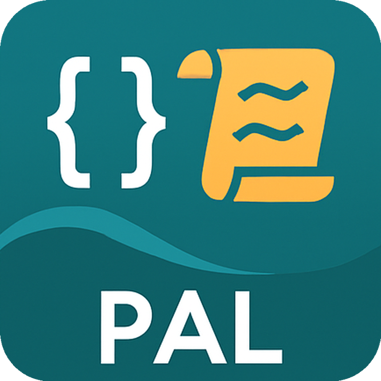

<div style="display: flex; align-items: center; gap: 15px;">
  
  <div>
    <h1 style="margin: 0;">Proteus Actuarial Library</h1>
    <p style="margin: 5px 0 0 0;">
      <a href="https://github.com/ProteusLLP/proteusllp-actuarial-library/actions/workflows/ci.yml">
        
      </a>
      <a href="https://codecov.io/gh/ProteusLLP/proteusllp-actuarial-library">
        
      </a>
      <a href="https://proteusllp-actuarial-library.readthedocs.io/en/latest/?badge=latest">
        
      </a>
      <a href="https://pypi.org/project/proteusllp-actuarial-library/">
        
      </a>
      <a href="https://pypi.org/project/proteusllp-actuarial-library/">
        
      </a>
      <a href="https://www.codefactor.io/repository/github/proteusllp/proteusllp-actuarial-library">
        
      </a>
      <a href="https://github.com/astral-sh/ruff">
        
      </a>
    </p>
  </div>
</div>

<br/>

An open-source stochastic actuarial modelling library in Python.

**Status:** PAL is in beta. The library is available on PyPI and its public API continues to be tested and refined.

## Introduction

The Proteus Actuarial Library (PAL) is a Python framework for building and running stochastic actuarial and financial models, including insurance capital models. It combines statistical modelling, simulation and reinsurance calculations in a consistent, inspectable API.

**Key features:**
- Probability distributions and maximum-likelihood fitting, including censored and truncated losses, with optional parameter uncertainty and model averaging
- Frequency-severity models, reinsurance contracts and multidimensional portfolios
- Copulas, automatic stochastic dependency tracking, and correlation matrix repair, completion and clustering
- Randomised quasi-Monte Carlo sampling across distributions and copulas to reduce simulation error
- NumPy/SciPy computation and optional CuPy GPU acceleration
- CSV, Parquet and pandas interchange, PAL object snapshots, and cloud file storage
- Documentation, executable recipes and agent tooling for AI-assisted modelling

## Quick Start

```python
from pal.copulas import GumbelCopula
from pal.distributions import Gamma, LogNormal

# Create stochastic variables
losses = Gamma(alpha=2.5, theta=2).generate()
expenses = LogNormal(mu=1, sigma=0.5).generate()

# Apply statistical dependencies
GumbelCopula(theta=1.2).apply([losses, expenses])

# Variables are now correlated
total = losses + expenses
```

## Installation

<!--pytest.mark.skip-->

```bash
# Basic installation
pip install proteusllp-actuarial-library

# With GPU support
pip install proteusllp-actuarial-library[gpu]
```

## Documentation

**[Read the full documentation on Read the Docs](https://proteusllp-actuarial-library.readthedocs.io/)**

- [Usage Guide](docs/usage.md) - Comprehensive examples and API documentation
- [Development Guide](docs/development.md) - Setting up the development environment and running tests
- [Runnable Python examples](src/pal/examples/) - Importable as `pal.examples` modules
- [Jupyter notebooks](examples/) - Interactive examples
- [Distribution fitting and uncertainty](docs/tutorials/distribution_fitting.md) - Maximum likelihood, parameter uncertainty and AICc-weighted model averaging
- [Correlation matrix tools](docs/source/api/correlation.rst) - Repair, completion, clustering and cliques
- [Randomised quasi-Monte Carlo](docs/tutorials/randomized_qmc.md) - Multidimensional sampling and copula examples
- [Data import and export](docs/tutorials/data_io.md) - CSV, Parquet, cloud storage and PAL snapshots
- [v0.4.0 release notes](docs/releases/v0.4.0.md) - Changes since v0.3.1

## AI and coding assistants

PAL provides dedicated entry points for AI tools as well as human-readable documentation:

- [PAL quick reference for coding assistants](docs/source/ai_assistants.md) maps common modelling intentions to the public Python API.
- Executable actuarial recipes are available through the generated `llms-full.txt` documentation and the installed `pal.api.recipes()` / `pal.api.recipe(id)` helpers.
- [PAL modelling agent skill](skills/pal-modeling/SKILL.md) can be installed in compatible assistants working on actuarial projects; [evaluation prompts](evals/README.md) measure assistant success using PAL.
- [AGENTS.md](AGENTS.md) contains canonical repository instructions for coding agents, with more-specific guidance under `src/pal/`, `tests/` and `docs/`.
- The documentation build publishes `llms.txt` and `llms-full.txt` at the documentation root for model-friendly retrieval.

To install the PAL modelling skill in a project that supports directory-based agent skills, clone the repository and run `python scripts/install_pal_skill.py --target .agents/skills`. Use `--force` to replace an earlier installation. Skill locations differ between coding assistants.

AI-generated PAL code should prefer documented public APIs and inspect signatures/docstrings rather than guessing parameterisations or relying on internal helpers.

## Project Status

PAL is available now and remains in beta while the API and numerical test coverage continue to develop. Distribution fitting, randomised quasi-Monte Carlo, GPU simulation, correlation matrix repair, and CSV/Parquet interchange are implemented today.

For outstanding work and feature requests, see the [issue tracker](https://github.com/ProteusLLP/proteusllp-actuarial-library/issues). A maintained [release checklist](docs/release_checklist.md) records the validation required before publication.

## Issues

Please log issues on our github [page](https://github.com/ProteusLLP/proteusllp-actuarial-library/issues).

## Contributing

You are welcome to contribute pull requests. Please see the [Contributor License Agreement](./CLA.md)

📚 **[Development Guide](docs/development.md)** - Get started with development setup and testing
