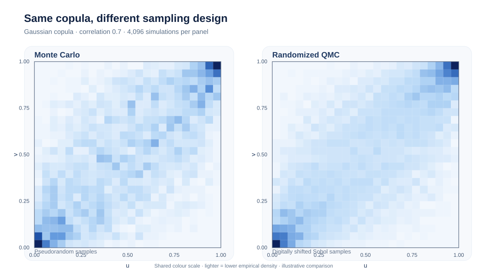

# Randomized quasi-Monte Carlo

Randomized quasi-Monte Carlo (RQMC) is an alternative to ordinary Monte Carlo.
It uses scrambled Sobol points to cover the sampling space more evenly and
can reduce simulation error. PAL handles the Sobol dimensions automatically,
so **your model code stays the same**.

## Try RQMC

Set the sampling method before generating your stochastic variables:

```python
from pal import set_random_seed
from pal.config import SamplingMethod, set_sampling_method
from pal.distributions import Gamma, Normal

set_sampling_method(SamplingMethod.RQMC)
set_random_seed(42)

claims = Gamma(alpha=2.5, theta=100_000).generate(4096)
inflation = Normal(mu=0.03, sigma=0.015).generate(4096)
total = claims * (1 + inflation)

assert len(total) == 4096

set_sampling_method(SamplingMethod.MC)  # Restore ordinary Monte Carlo
```

For a fair comparison, use the same model and simulation count under both
sampling methods, varying the seed across independent runs.

## What do the samples look like?

These heatmaps show two ways of simulating a Gaussian copula with correlation
0.7. Each panel contains 4,096 simulated pairs, with the same density scale.



The RQMC points distribute more evenly. The copula dependence is the same;
the sampling design changes.

## Does it improve accuracy?

Here the quantity being estimated is the probability that **both** copula
margins exceed their 90th percentiles. Each point reports root-mean-squared
error (RMSE) over 24 independent randomizations.


RQMC improves accuracy in this example. It will not help every model to the
same extent, particularly with high-dimensional or discontinuous losses.

The figures illustrate two-dimensional digitally shifted Sobol sampling. PAL
uses scrambled multidimensional Sobol blocks, so its exact samples and
performance measurements will differ. For **interactive Plotly charts generated
using PAL**, run the packaged example:

<!--pytest-codeblocks:skip-->

```bash
python -m pal.examples.example_qmc_vs_mc --output qmc-plots
```

This produces copula density plots for Gaussian and Student-t copulas, plus
an MC-versus-RQMC convergence chart.

## Two things to remember

**Use powers of two** such as 4,096 or 16,384 when convenient, to retain the
strongest Sobol balance properties.

**Use independent scrambles to estimate error.** The paths from one RQMC
run are not independent Monte Carlo observations. Repeat the calculation with
different seeds when estimating uncertainty.

For more on dependence, see the [copula tutorial](coupling_groups_and_copulas.md).
