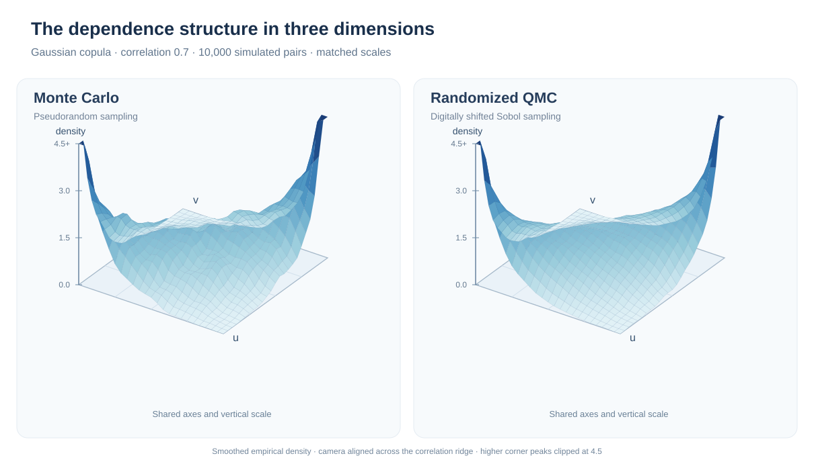
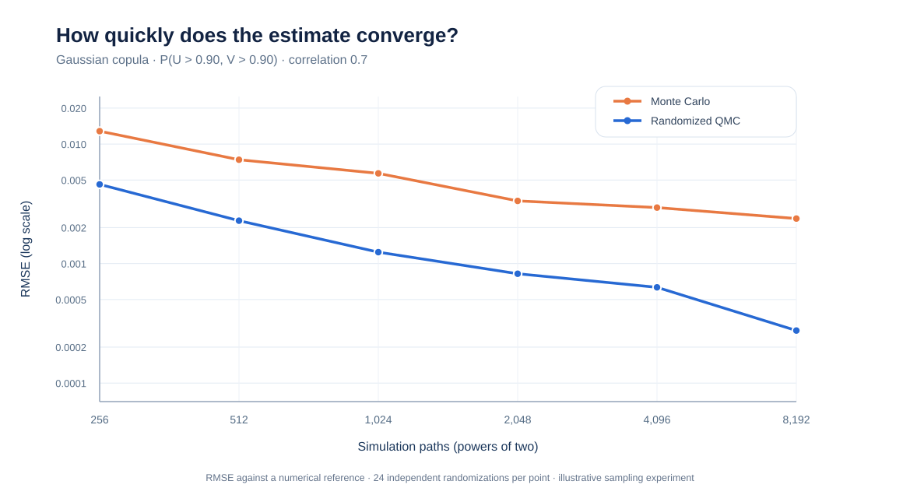

# Randomized quasi-Monte Carlo

Randomized quasi-Monte Carlo (RQMC) uses scrambled Sobol points to cover
the sampling space more evenly than ordinary Monte Carlo. It can reduce
simulation error without requiring changes to the model itself.

## Switching sampling methods

Set the sampling method before generating your stochastic variables.
PAL uses the configured default number of simulations when you call
`generate()` without an argument.

```python
from pal import set_random_seed
from pal.config import SamplingMethod, set_sampling_method
from pal.distributions import Gamma, Normal

set_sampling_method(SamplingMethod.RQMC)
set_random_seed(42)

claims = Gamma(alpha=2.5, theta=100_000).generate()
inflation = Normal(mu=0.03, sigma=0.015).generate()
total = claims * (1 + inflation)

set_sampling_method(SamplingMethod.MC)  # Restore Monte Carlo
```

## Comparing copula samples

For example, we can generate the same Gaussian copula using both methods.
The `generate()` calls use PAL's default simulation count.

```python
from pal import set_random_seed
from pal.config import SamplingMethod, set_sampling_method
from pal.copulas import GaussianCopula

copula = GaussianCopula([[1.0, 0.7], [0.7, 1.0]])

set_sampling_method(SamplingMethod.MC)
set_random_seed(42)
u_mc, v_mc = copula.generate()

set_sampling_method(SamplingMethod.RQMC)
set_random_seed(42)
u_rqmc, v_rqmc = copula.generate()

set_sampling_method(SamplingMethod.MC)
```

These 3D surfaces show the **empirical copula density** estimated from each
set of simulated pairs. Both surfaces use the same axes and height scale.



The RQMC surface is typically smoother because its points cover the
sampling space more evenly. These are estimated densities, not the
analytical copula density. The static illustration uses 10,000 pairs and
two-dimensional digitally shifted Sobol sampling; exact PAL samples depend
on the configured scramble and seed.

## Does it improve accuracy?

Here we estimate the probability that **both** Gaussian copula margins exceed
their 90th percentiles. The chart shows root-mean-squared error across 24
independent runs.



RQMC gives a lower error in this example, but the improvement depends on
the model and the quantity being estimated.

**Two practical points:** a power-of-two simulation count gives the strongest
Sobol balance properties, although PAL's default count also works. To
estimate uncertainty under RQMC, repeat the model using independent seeds.
Individual paths in one scrambled design are not independent observations.

For more on dependence, see the [copula tutorial](coupling_groups_and_copulas.md).
