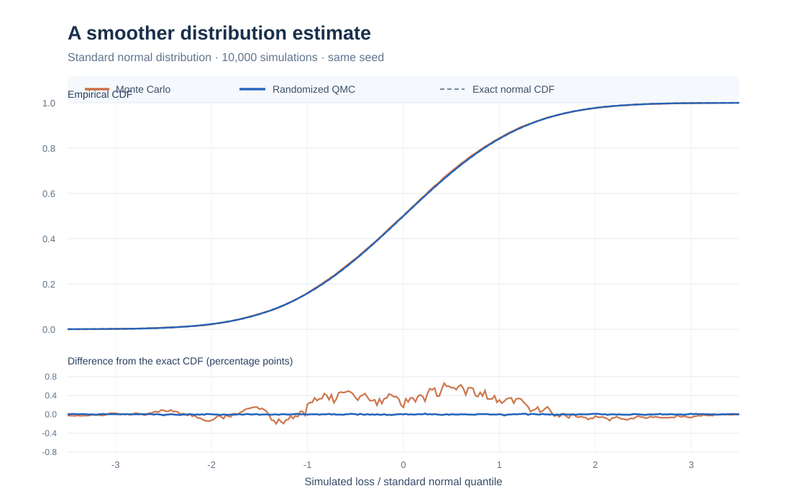

# Randomized quasi-Monte Carlo

Randomized quasi-Monte Carlo (RQMC) improves the coverage of simulated
probabilities. It is similar in spirit to **stratified sampling across multiple
dimensions**: scrambled Sobol points spread samples through the unit cube
more evenly than independent pseudorandom draws. This can reduce simulation
error without changing the model.

## One distribution

Start with a standard normal distribution, using the same number of draws
under Monte Carlo and RQMC:

```python
from pal import set_random_seed
from pal.config import SamplingMethod, set_sampling_method
from pal.distributions import Normal

normal = Normal(mu=0, sigma=1)

set_sampling_method(SamplingMethod.MC)
set_random_seed(42)
mc = normal.generate()

set_sampling_method(SamplingMethod.RQMC)
set_random_seed(42)
rqmc = normal.generate()

set_sampling_method(SamplingMethod.MC)
```

The empirical cumulative distribution function (CDF) is much smoother under
RQMC. At this simulation count, the curves nearly coincide, so the lower
panel shows their deviations from the exact normal CDF.



## Sampling in multiple dimensions

The same idea extends to dependent variables. For example, this generates
two uniform marginals from a Gaussian copula with correlation 0.7:

```python
from pal import set_random_seed
from pal.config import SamplingMethod, set_sampling_method
from pal.copulas import GaussianCopula

copula = GaussianCopula([[1.0, 0.7], [0.7, 1.0]])

set_sampling_method(SamplingMethod.MC)
set_random_seed(42)
u_mc, v_mc = copula.generate()

set_sampling_method(SamplingMethod.RQMC)
set_random_seed(42)
u_rqmc, v_rqmc = copula.generate()

set_sampling_method(SamplingMethod.MC)
```

The surfaces show the estimated joint densities from Monte Carlo and RQMC
samples, viewed across the dependence ridge. Both plots use the same axes
and density scale.


Each surface is a smoothed empirical estimate, rather than the analytical
copula density. The illustrative RQMC surface uses digitally shifted
two-dimensional Sobol points.

## Does it improve accuracy?

The following example estimates the probability that **both** copula
marginals exceed their 90th percentiles. The chart compares root-mean-squared
errors across independent runs.


RQMC can improve precision substantially, but the gain depends on the model,
its effective dimension and the quantity being estimated.

A power-of-two simulation count gives the strongest Sobol balance
properties. To estimate simulation uncertainty under RQMC, repeat the
calculation with independent seeds rather than treating the paths within a
single scramble as independent observations.

## RQMC methods and references

PAL uses scrambled Sobol sampling. On **CPU**, SciPy applies a linear matrix
scramble followed by a digital shift (LMS+shift). On **GPU**, PAL uses
cuRAND's scrambled Sobol direction vectors with an additional seeded digital
shift. The scrambling method is determined by the backend; PAL does not
currently provide a choice of scrambling algorithms, and nested Owen
scrambling is not separately implemented.

For the theory and practical details, see:

- [Owen (1997), *Monte Carlo variance of scrambled net quadrature*](https://doi.org/10.1137/S0036142994277468).
- [Owen (1998), *Scrambling Sobol' and Niederreiter–Xing points*](https://doi.org/10.1006/jcom.1998.0487).
- [SciPy's Sobol sampler documentation](https://docs.scipy.org/doc/scipy/reference/generated/scipy.stats.qmc.Sobol.html).

For more on modelling dependence, see the [copula tutorial](coupling_groups_and_copulas.md).
